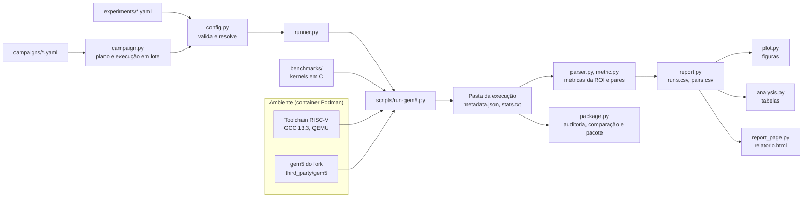

# Arquitetura

Como as partes do framework se ligam: do YAML de um experimento à pasta da execução, e das execuções às tabelas, aos gráficos e ao pacote de dados. O que cada parte faz em detalhe está no documento indicado em cada uma. A instalação está em [installation.md](installation.md), e a reprodução dos resultados em [reproducibility.md](reproducibility.md).

| Parte | Situação |
| --- | --- |
| Todas as camadas descritas aqui | Existente |
| Rede completa, dataset real, modo FS do gem5 | Fora do escopo ([scope.md](scope.md#fora-do-escopo), [future.md](future.md)) |

## Visão geral

O fluxo tem quatro camadas:

1. **Ambiente.** Um container Podman com a toolchain RISC-V, o QEMU e o Python, e o gem5 do fork compilado na pasta do projeto ([container.md](container.md), [environment.md](environment.md)).
2. **Benchmarks.** As sete operações de CNN int8 em C, cada uma em três variantes, sobre uma base comum que gera os dados, confere o resultado e marca a região de interesse ([kernel_base.md](kernel_base.md), [kernels.md](kernels.md)).
3. **Execução.** Um YAML descreve uma simulação. O framework o valida, compila o benchmark e chama o gem5, e cada execução ganha uma pasta própria com a proveniência ([experiments.md](experiments.md), [results.md](results.md)). Uma campanha gera e executa muitos YAMLs ([campaigns.md](campaigns.md)).
4. **Resultados.** As métricas saem do `stats.txt` de cada pasta, viram tabelas em CSV, gráficos, tabelas de análise, uma página HTML e, no fim, um pacote de dados ([report.md](report.md), [plots.md](plots.md), [analysis.md](analysis.md), [html_report.md](html_report.md), [data.md](data.md)).

## Uma execução, passo a passo

`riscvcnnbench run experiments/fc_s.yaml` (ou `make run EXPERIMENT=...`):

1. **Validar.** `config.py` lê o YAML com o modelo Pydantic, reúne todos os problemas com a linha de cada um e preenche os padrões. Um `scenario` vira as seções `cache` e `memory` de `configs/scenarios.yaml`. O resultado é a configuração resolvida.
2. **Preparar.** `runner.py` confere o gem5 e a toolchain e monta o comando de build: o `make` da pasta do benchmark, com a variante (`VARIANT=ref|custom|rvv`) e as flags do YAML.
3. **Executar.** `scripts/run-gem5.py` cria a pasta da execução (`<output.dir>/<run_id>/`, nunca reaproveitada), compila o benchmark em `inputs/`, registra a proveniência e roda o gem5 com `configs/gem5/se_riscv_configurable.py` e os argumentos que `gem5_args()` tirou da configuração.
4. **Simular.** O script de configuração roda dentro do gem5. Ele monta a CPU (atomic, timing, minor, o3 ou o3-edge), as caches e a memória pedidas e executa o binário em modo SE (emulação de chamadas de sistema). O benchmark chama as m5ops no início e no fim do kernel, e o `stats.txt` sai com um bloco para a região de interesse e outro para o resto do programa.
5. **Registrar.** O wrapper grava o `metadata.json`: status, códigos de saída, commit e estado do Git do projeto e do fork, hashes do binário, da configuração e do gem5, a imagem do container e o compilador.
6. **Resumir.** O `run` termina com um resumo. Se falhou, `runs.py` diagnostica a causa pelos logs e aponta o arquivo.

O programa simulado confere o próprio resultado contra um oráculo e imprime a linha `RESULT` com o checksum. O código de saída do programa diz se o resultado bateu.

## Uma campanha

`riscvcnnbench campaign run campaigns/final.yaml`:

1. `campaign.py` lê a matriz e faz o produto de cada grupo: experimentos base × valores de `vary`. Cada combinação vira um YAML de experimento comum em `<pasta da campanha>/experiments/`.
2. Combinações iguais depois da normalização rodam uma vez só. A identidade é a `config_key`, o hash da configuração resolvida sem nome, descrição e pasta. Campos que não afetam uma combinação saem antes do hash, como a latência das instruções personalizadas na variante de referência.
3. Com `validate: true`, roda antes a validação de equivalência entre as variantes (`pytest -m validation`).
4. As combinações rodam em paralelo, cada uma como um `riscvcnnbench run` normal, em `runs/<nome>/<run_id>/`. Uma retomada pula as concluídas com o mesmo gem5 e a mesma chave.
5. `campaign status` mostra o estado de cada uma; `campaign audit` diz se a campanha vale como resultado; `campaign diff` compara com outra campanha, como a publicada; `campaign package` gera o pacote de dados.

`estimate.py` estima o tempo de uma matriz antes de rodá-la, a partir de execuções medidas ([matrix.md](matrix.md)).

## Dos resultados às tabelas

| Etapa | Módulo | Entrada | Saída |
| --- | --- | --- | --- |
| Métricas de uma execução | `parser.py` | `stats.txt`, `config.ini` | Métricas brutas da ROI (`METRICS`, o único lugar com nomes de estatísticas do gem5) |
| Derivadas e pares | `metric.py` | Pastas de execução | CPI, MPKI, por MAC; pares de variante e de compilador com R_I, S_C e razão de IPC |
| Tabelas | `report.py` | Uma pasta (campanha ou `results/`) | `report/runs.csv`, `report/pairs.csv` |
| Gráficos | `plot.py` | `report/` | `figures/*.pdf`, `*.png`, `figures.json` |
| Análise | `analysis.py` | `report/` | `analysis/*.csv`, `tables.md` |
| Página de resultados | `report_page.py`, `web/relatorio.*` | `report/`, `analysis/` | `relatorio.html` |
| Auditoria, comparação e pacote | `package.py` | Pasta da campanha (e, no `diff`, a de referência) | Relatório da auditoria; diferenças por combinação; `.tar.gz` com MANIFEST e SHA256SUMS |

Todas leem as pastas de execução ou os CSVs. Nenhuma refaz uma simulação.

## Módulos

| Caminho | Papel | Documento |
| --- | --- | --- |
| `src/riscvcnnbench/cli.py` | Interface de linha de comando (Typer): `run`, `runs`, `stats`, `compare`, `report`, `plot`, `analyze`, `relatorio`, `gerador`, `ambiente`, `campaign plan\|run\|status\|estimate\|audit\|package` | README |
| `src/riscvcnnbench/config.py` | Formato do YAML, validação com mensagens por linha, cenários, configuração resolvida, argumentos do gem5 | [experiments.md](experiments.md) |
| `src/riscvcnnbench/runner.py` | Da configuração ao comando: build e chamada do wrapper | [experiments.md](experiments.md#como-o-yaml-vira-simulação) |
| `src/riscvcnnbench/runs.py` | Listagem, diagnóstico de falhas, métricas por execução | [results.md](results.md) |
| `src/riscvcnnbench/parser.py` | Blocos do `stats.txt`, região de interesse, métricas brutas | [results.md](results.md#métricas) |
| `src/riscvcnnbench/metric.py` | Métricas derivadas, trabalho por operação, pares | [results.md](results.md#métricas-derivadas-e-comparações) |
| `src/riscvcnnbench/campaign.py` | Matriz, plano, execução em lote, estados, validação | [campaigns.md](campaigns.md) |
| `src/riscvcnnbench/estimate.py` | Estimativa de tempo de uma matriz | [matrix.md](matrix.md) |
| `src/riscvcnnbench/report.py`, `plot.py`, `analysis.py` | CSV, gráficos e tabelas da análise | [report.md](report.md), [plots.md](plots.md), [analysis.md](analysis.md) |
| `src/riscvcnnbench/package.py` | Auditoria e pacote de dados | [data.md](data.md) |
| `src/riscvcnnbench/generator.py`, `report_page.py`, `web/` | Páginas HTML autônomas: gerador de experimentos e relatório de resultados | [generator.md](generator.md), [html_report.md](html_report.md) |
| `src/riscvcnnbench/environment.py` | Conferência do ambiente | [container.md](container.md) |
| `scripts/run-gem5.py`, `provenance.py`, `record-gem5-build.py` | Wrapper de uma execução, proveniência e registro do build do gem5; só biblioteca padrão | [results.md](results.md), [hello_riscv.md](hello_riscv.md) |
| `configs/gem5/se_riscv_configurable.py` | Configuração do gem5: CPU, caches, memória, latência das instruções, caches frias; roda dentro do gem5 | [scenarios.md](scenarios.md) |
| `configs/gem5/se_riscv.py` | Configuração de referência (atomic, sem cache), equivalente aos padrões do YAML | [hello_riscv.md](hello_riscv.md) |
| `configs/scenarios.yaml` | Os quatro cenários de memória nomeados | [scenarios.md](scenarios.md) |
| `benchmarks/common/` | Base dos kernels, oráculos, instruções personalizadas (`cnn_insn.h`), blocos RVV, `kernel.mk` | [kernel_base.md](kernel_base.md), [custom_instructions.md](custom_instructions.md) |
| `benchmarks/<operação>/` | `main.c` comum e `kernel_ref.c`, `kernel_custom.c`, `kernel_rvv.c` | [kernels.md](kernels.md) |
| `experiments/`, `campaigns/` | YAMLs das operações em S e L; matrizes (exemplo, piloto, medição, final) | [experiments.md](experiments.md), [matrix.md](matrix.md) |
| `third_party/gem5` | Submódulo: fork do gem5 com as instruções e a classe `CnnMult` | [environment.md](environment.md) |
| `tests/` | Testes rápidos (`make test`), de ponta a ponta (`make e2e-test`) e de validação (`make validate`) | README |

## Decisões de projeto

- **Um YAML, uma execução.** Uma varredura é uma campanha, que gera YAMLs comuns. Assim, qualquer combinação pode ser rodada de novo sozinha com `riscvcnnbench run <pasta da campanha>/experiments/<nome>.yaml`.
- **Pastas nunca reaproveitadas.** Cada execução tem o próprio `run_id`. Repetir uma combinação acrescenta uma pasta, e a mais recente vale (`current` no `runs.csv`).
- **`completed` não quer dizer correto.** É o retorno zero do gem5. A validade vem da linha `RESULT`, do checksum comparado entre variantes e da proveniência limpa.
- **Proveniência em cada pasta.** O commit e o estado do Git (do projeto e do fork), os hashes e o ambiente vão no `metadata.json` no início da execução, para que a pasta se explique sozinha.
- **Região de interesse por m5ops.** O kernel é medido sem a geração dos dados e a conferência. O parser exige o número esperado de blocos e recusa o arquivo em vez de ler o bloco errado.
- **Dois mundos de Python.** O framework roda no Python do `.venv`; o script de configuração roda dentro do gem5, com o módulo `m5`. Eles se falam pelos argumentos de linha de comando que `gem5_args()` monta.
- **Scripts só com a biblioteca padrão.** O wrapper e a proveniência funcionam fora do `.venv` e não dependem das versões das bibliotecas.
- **Dados sintéticos e avaliação por operação.** Sem rede completa nem dataset; os dados vêm de um gerador determinístico com semente fixa ([scope.md](scope.md)).

## Onde estender

| Para | Mexa em | Veja |
| --- | --- | --- |
| Um benchmark novo | Pasta em `benchmarks/` com Makefile, que confere o próprio resultado e sinaliza pelo código de saída | [kernel_base.md](kernel_base.md#roteiro-de-um-benchmark) |
| Um campo novo no YAML | `config.py` (modelo e `gem5_args()`), `se_riscv_configurable.py`, `docs/experiments.md`, `experiments/hello_param_cache.yaml`, `tests/test_config.py` | [experiments.md](experiments.md#campos) |
| Uma instrução nova | `cnn_insn.h`, o fork do gem5 (`src/arch/riscv/insts/cnn.hh`, `decoder.isa`) e os casos de `cnn_insn_semantics` | [custom_instructions.md](custom_instructions.md) |
| Uma métrica nova | `METRICS` em `parser.py` e, se derivada, `DERIVED` em `metric.py` | [results.md](results.md#métricas) |
| Algo que pede mais | Os níveis de esforço e o que cada extensão exige | [future.md](future.md) |
